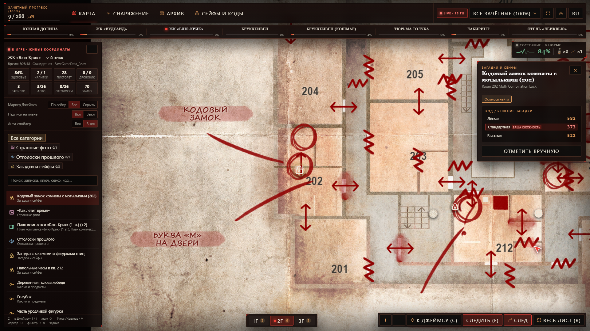

# SILENT HILL 2 — Live Companion Map

[Русский](README.ru.md) · Version 0.1.0 · Steam guide: [English](https://steamcommunity.com/sharedfiles/filedetails/?id=3844641036) · [Русский](https://steamcommunity.com/sharedfiles/filedetails/?id=3844642338)

Full-screen desktop, second-monitor & touch tablet companion suite for **SILENT HILL 2 Remake (Steam, PC / Unreal Engine 5)**. Combines all **41 native paper map sheets**, 15 Hz zero-lag read-only live telemetry & 60 FPS interpolated James tracking, full **Loadout / Equipment / Arsenal / Survival Stats** dossier, **Archive** (26 Polaroid gallery, 76 Memos RU/EN reader, 8 Chapters), and **Safes & Codes** cheat-sheet — installable as a fullscreen PWA over Wi-Fi or USB cable (`adb reverse`).



## Highlights

- **Four Instant Views (`Map` / `Loadout` / `Archive` / `Safes & Codes`):** Switch without reloading between the interactive paper blueprint, real-time ECG health / flashlight / radio / weapon ammo / pocket clues / survival statistics, all 26 Strange Polaroids + searchable RU/EN Memos + 8-Chapter matrix, and a difficulty-highlighted Safe & Padlock reference.
- **Always-Visible Live Clinical ECG Pulse HUD:** Live animated ECG monitor on both the Map and Loadout views showing James's 4-tier vital state (`Fine` / `Caution` / `Danger` / `Critical`), reactive pulse color & heartbeat speed, health percentage, and Health Drinks / Syringes counts at 15 Hz via SSE.
- **Large Inspect Lightbox (Photos, Memos & Clues):** Open any Strange Polaroid, Memo, Personal Item (Mary's Photo, Mary's Letter), Key, or Puzzle Clue full-size with crisp locally extracted high-res renders (up to `768 px`), official in-game descriptions, full `RU` / `EN` transcripts, and keyboard/touch `‹ / ›` browsing.
- **Zero-Lag Real-Time SSE Stream (`15 Hz` ticks + instant state sync):** Persistent read-only `PROCESS_VM_READ` (`0x0410`) session reads James's `(X, Y, Z)` coordinates, camera yaw/FOV, health, collected inventory, flashlight/radio states, loaded magazine ammo, equipped weapon, memos, kill breakdowns, and live `MapsObjectsData` red-marker edits, pushing delta updates to the browser with 60 FPS interpolated movement and optional breadcrumb trail.
- **All 41 Native Paper Maps (`2048 × 2048`):** South Vale (Observation Trail, East & West in Fog & Otherworld), Wood Side Apartments (1F–3F), Blue Creek Apartments (1F–3F), Brookhaven Hospital (BF–3F in Fog & Otherworld), Toluca Prison (6 sections), Labyrinth (Hub & 4 paths), and Lakeview Hotel (7 Clean maps before Room 312 VHS + 4 Burnt maps after VHS).
- **Zero External Dependencies:** Paper textures, 48 red-marker sprites, high-res item & Polaroid renders, room/street labels, item descriptions, transcripts, and `EN`/`RU` localization are unpacked locally on first launch from your installed `SILENT HILL 2` archive into `%LOCALAPPDATA%\sh2-companion-map\`.
- **Tablet-First Touch & Cross-Floor Search:** Momentum panning, double-tap zoom, fullscreen & Screen Wake Lock buttons, global search across all 41 floors, plus responsive landscape (`1280 × 800`) and portrait (`800 × 1280`) layouts.

## Quick Start

Run **`start.bat`**. It sets up `.venv`, installs `requirements.txt`, extracts local map & item assets on first run, and opens **http://127.0.0.1:8791/**.

For an Android tablet connected via **USB cable** (zero Wi-Fi latency via `adb reverse tcp:8791 tcp:8791`):

```bat
tablet_usb.bat
```

Or for a phone or tablet on your local Wi-Fi:

```bat
start.bat --lan
```

Optional: run the server silently on Windows logon (LAN mode on port `8791`, no console window) after running `start.bat` once:

```bat
powershell -ExecutionPolicy Bypass -File install_autostart.ps1
```

## Shortcuts

- **`C`** — Center on James & switch to his active floor
- **`F`** — Toggle Auto-Follow James
- **`[` / `]`** — Previous / Next floor
- **`X`** — Flip between **Fog World ⇄ Otherworld** (or *Clean ⇄ Burnt* Hotel)
- **`M`** — Cycle James's Red Marker layer (*Save-synced → All → Off*)
- **`U`** — Cycle pin filter (*Remaining → All Scored → +Loot → Full Blueprint*)
- **`R`** — Fit map sheet to viewport
- **`1–8`** — Jump between the 8 chapters/buildings
- **`Tab`** — Toggle left HUD panel

## Development & Cleanliness Check

```bat
python -m pip install -r requirements-dev.txt
python -m pytest -q
python tools\check_clean.py
```

## Support

This companion is free and open-source. If it saved you from pausing to check the map every 30 seconds and you'd like to say thanks, every donation goes directly into building more free game tools and covering the AI subscriptions used to develop them:

- **monobank jar** (cards from any country, Apple Pay, Google Pay) — <https://send.monobank.ua/jar/3zsHTXdRbt> · jar card `4874 1000 3320 3608`
- **PayPal** — [payment details on the support page](https://alexsander720.github.io/continue/#support)
- **USDT · TRC20** (Tron) — `TKhmtVEnuU5w73YMPT8adh7t3VZKJUUxmC`
- **USDT · BEP20** (BNB Smart Chain) — `0xDC0c682922bF3194693774743fBB3fd20E7754c3`

## Disclaimer & License

Unofficial fan companion, not affiliated with or endorsed by **Konami Digital Entertainment** or **Bloober Team**. Game memory and save files are accessed strictly read-only. No game assets, textures, or localized strings are bundled in this repository. Code is provided under the [MIT License](LICENSE).
