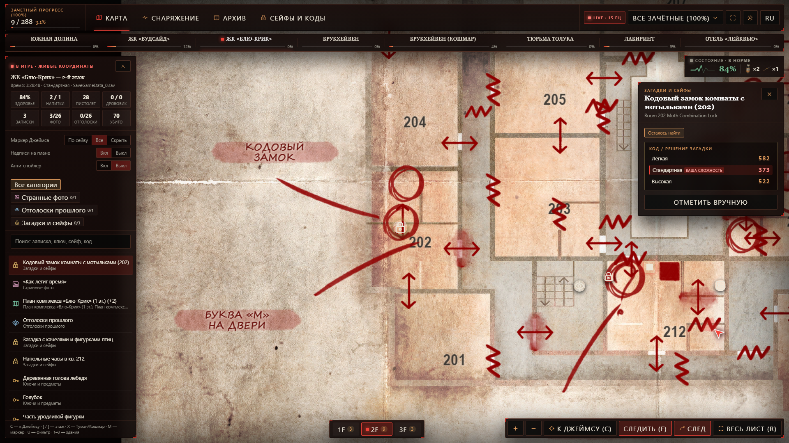

# SILENT HILL 2 — Живая карта-компаньон

[English](README.md) · Версия 0.1.0 · Руководство в Steam: [русское](https://steamcommunity.com/sharedfiles/filedetails/?id=3844642338) · [английское](https://steamcommunity.com/sharedfiles/filedetails/?id=3844641036)

Полноэкранный планшет-компаньон и интерактивная карта второго экрана для **SILENT HILL 2 Remake (Steam, PC / Unreal Engine 5)**. Объединяет все **41 родных бумажных листа**, поток живой телеметрии без задержек (`15 Гц` SSE + интерполяция `60 FPS`), полное досье **Снаряжения** (ЭКГ здоровья, фонарик/радио, магазин/запас патронов, ключи в кармане, статистика боя), **Архив** (26 полароидов, читалка записок `RU`/`EN`, прогресс по 8 главам) и справочник **Сейфов и кодов** с подсветкой вашей сложности. Поддерживает прямой запуск на Android-планшете по USB-кабелю и режим PWA.



## Возможности

- **Четыре вкладки в реальном времени («Карта» · «Снаряжение» · «Архив» · «Сейфы и коды»):** мгновенное переключение между бумажной схемой этажей, состоянием Джеймса и арсеналом, галереей 26 странных фото / 72+ записок / 8 глав и таблицей всех замков.
- **Живой ЭКГ-пульс прямо на карте и в снаряжении:** всегда видимый виджет состояния Джеймса (`В норме` / `Ранен` / `Опасность` / `При смерти`) с анимированной линией ЭКГ (цвет и частота биения реагируют на здоровье в реальном времени), процентом HP и счётчиками лечебных напитков и шприцев.
- **Крупный осмотр фото, писем, записок и улик:** единое полноразмерное окно осмотра для странных полароидов, записок, личных вещей Джеймса (фото и письмо Мэри), ключей и предметов загадок — с локально извлечёнными high-res рендерами (до `768 px`), официальными описаниями, полным текстом (`RU` / `EN`) и перелистыванием `‹ / ›`.
- **Живой поток телеметрии без задержек (`PROCESS_VM_READ`, `0x0410`):** постоянная read-only сессия читает координаты `(X, Y, Z)`, угол и FOV камеры, здоровье, активный этаж `ASHGameplayMapVolume`, текущий инвентарь, состояние фонарика/радио, патроны в стволе, взятое оружие, записки, убийства по видам оружия и свежие пометки `MapsObjectsData`. SSE `/api/stream` шлёт тики на `15 Гц` и события обновления, а стрелка Джеймса и опциональный след рисуются плавно на `60 FPS`.
- **Все 41 бумажных плана игры (`2048 × 2048`):** Южная долина, «Вудсайд», «Блю-Крик», Больница «Брукхейвен» (Туман и Кошмар), Тюрьма «Толука», Лабиринт и Отель «Лейквью» (до и после кассеты в номере 312).
- **100% локальная автономность:** текстуры бумажных карт, 48 спрайтов красного маркера Джеймса, high-res рендеры предметов и полароидов, описания, тексты записок, подписи комнат и локализация (`RU` / `EN`) извлекаются локально при первом запуске из установленной игры в `%LOCALAPPDATA%\sh2-companion-map\`.
- **Адаптация под планшет и глобальный поиск:** инерционный скролл, двойной тап по карте для зума, кнопки «Весь экран» и «Не гасить экран» (Wake Lock), глобальный поиск по всем 41 этажу сразу, ландшафтный (`1280 × 800`) и портретный (`800 × 1280`) режимы.

## Требования

- Windows 10/11 (64-бит), Python 3.11 или новее (`py` или `python`).
- Установленная Steam-версия **SILENT HILL 2** (AppID `2124490`) для первичной распаковки бумажных карт, чтения сейвов и живых координат.
- Современный браузер на втором мониторе, планшете или телефоне в локальной сети.

Проверенный профиль живой памяти `KNOWN_BUILDS`: **`SHProto-Win64-Shipping.exe` (142 126 592 байт, PE timestamp `1737472969` / `0x678FBBC9`, сборка 1.0.0.5)**.

## Запуск

Запустите **`start.bat`**. Скрипт создаст `.venv`, установит зависимости из `requirements.txt`, распакует локальные карты, рендеры предметов и локализацию в `%LOCALAPPDATA%\sh2-companion-map\` и откроет **http://127.0.0.1:8791/**.

Для планшета, подключённого **по USB-кабелю** (минимальная задержка через `adb reverse tcp:8791 tcp:8791`):

```bat
tablet_usb.bat
```

Или для телефона/планшета в домашней Wi-Fi сети:

```bat
start.bat --lan
```

Автозапуск в фоне при включении Windows (без окна консоли, сразу в LAN-режиме на порту `8791`; запускать один раз после первого прогона `start.bat`):

```bat
powershell -ExecutionPolicy Bypass -File install_autostart.ps1
```

Дополнительные флаги:

```bat
start.bat --port 8891
start.bat --game-dir "<путь к папке SILENT HILL 2>"
start.bat --save-dir "<путь к папке SaveGames>"
start.bat --no-browser
```

## Горячие клавиши

- **`C`** — центрировать на Джеймсе и перейти на его текущий этаж
- **`F`** — включить/выключить автоследование за Джеймсом
- **`[` / `]`** (или `PgDn` / `PgUp`) — переключить этаж ниже / выше
- **`X`** — мгновенный переход между парой **Туманный мир ⇄ Потусторонний мир** (или *До кассеты ⇄ После кассеты* в Отеле)
- **`M`** — режим красного маркера Джеймса (*По сейву → Все → Скрыть*)
- **`U`** — режим фильтрации меток (*Осталось → Зачётные → +Лут → Все двери*)
- **`R`** — вписать весь бумажный лист в экран
- **`1–8`** — быстрый переход по 8 главам/зданиям
- **`Tab`** — свернуть/развернуть левую панель

## Проверка и тесты

```bat
python -m pip install -r requirements-dev.txt
python -m pytest -q
python tools\check_clean.py
```

## Поддержать проект

Карта-компаньон бесплатна и открыта. Если она помогла пройти Сайлент Хилл без лишних пауз — можно поддержать автора: каждый донат идёт в разработку новых бесплатных утилит для игр и оплату ИИ-подписок, с которыми они создаются:

- **Банка monobank** (карты любых стран, Apple Pay, Google Pay) — <https://send.monobank.ua/jar/3zsHTXdRbt> · карта банки `4874 1000 3320 3608`
- **PayPal** — [реквизиты на странице поддержки](https://alexsander720.github.io/continue/#support)
- **USDT · TRC20** (Tron) — `TKhmtVEnuU5w73YMPT8adh7t3VZKJUUxmC`
- **USDT · BEP20** (BNB Smart Chain) — `0xDC0c682922bF3194693774743fBB3fd20E7754c3`

## Отказ от ответственности и лицензия

Неофициальный фан-проект, не связан с **Konami Digital Entertainment** или **Bloober Team**. Память процесса и файлы сохранений открываются строго в режиме «только чтение». Репозиторий не содержит извлечённых игровых текстур, шрифтов, текстов локализации или сохранений — все игровые ресурсы распаковываются локально из вашей лицензионной копии игры. Код распространяется по [лицензии MIT](LICENSE).
